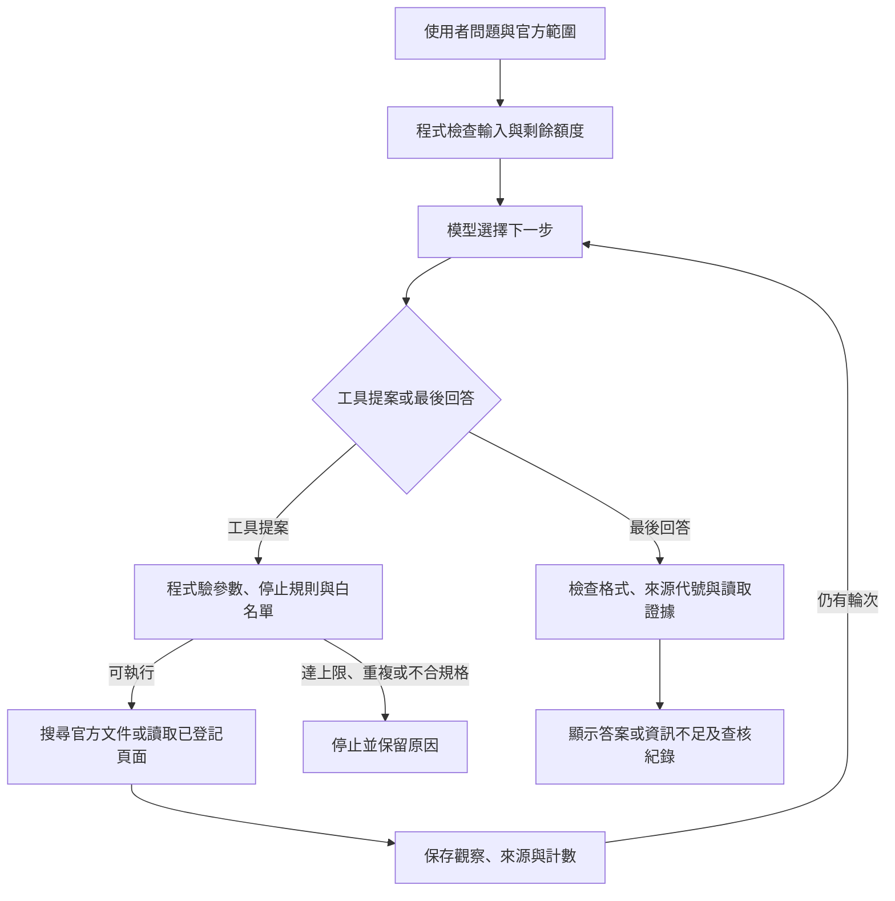

# 第14週｜Agent基礎與工作流程：教材規劃

規劃日期：2026-11-26。沿用 Codex 主線與第13週現行修訂版。本文件保留製作前的設計規格；同日已依使用者要求完成首版，入口見[教師導讀與驗證紀錄](第14週_教師導讀與驗證紀錄.md)。以下「待製作」為原規劃用語，實作狀態見第14節。

## 1 本週主線與前後週銜接

本週製作「會選工具、會看結果、也會停下來的官方文件查核助手」。沿用第13週的 Python／Streamlit 官方文件情境，讓學生把注意力放在 Agent 如何決定下一步。

開場先問：「第一次找到的資料沒有回答問題，接下來該換關鍵字、打開原文，還是承認查不到？」由這個短情境帶出 planning、tool use、observation 與 final answer。模型提出下一步，程式檢查與執行，工具結果再交回模型；步數、權限與費用上限由程式掌握。

| 週次 | 已有能力或本週安排 | 本週如何銜接 |
|---|---|---|
| 第2、3、5週 | 函式、dict／list、JSON、Responses API、對話歷史 | 用普通變數與有限 `for` 迴圈保存工具往返，不新增 Agent 類別 |
| 第6週 | Schema、Structured Outputs、格式與事實的差別 | 沿用 strict 函式輸入規格，最後答案再檢查欄位與來源 |
| 第7週 | 表單觸發、session state、下載與金鑰管理 | 同一套核心函式移入 App，表單提交才開始一個任務 |
| 第11、12週 | 證據回查、資訊不足與未知欄位 | 答案必須能回查原文；查不到與工具失敗分開記錄 |
| 第13週現行修訂版 | `prepare_search` → `build_search_task` → 內建 `web_search`，固定兩階段 | 保留搜尋規格與官方範圍，改由單一 Agent 選擇搜尋或閱讀，根據觀察決定下一步 |
| 第15週 | 課綱安排 MCP、部署與專題測試，目前尚無教材資料夾 | 把本週工具契約、請求紀錄與錯誤紀錄帶入部署檢核；再比較外部工具如何透過 MCP 連接 |
| 第16週 | 期末專題展示，目前尚無教材資料夾 | Agent 題目需能展示實際工具選擇、多步驟紀錄與停止原因 |

課綱依據：[18週課程大綱](../生成式AI應用開發_16周課程大綱.md)第七、十三及十六節。先備教材以[第13週修訂版教師導讀](../week13/第13週_課堂簡化版修訂版_教師導讀與修訂紀錄.md)及其配套為準；第13週較早的會議筆記規劃僅為歷史參考。

### 1-1 學習目標與可觀察成果

| 學生應能做到 | 完成證據 |
|---|---|
| 說明固定工作流程與 Agent 的差別 | 從兩份 trace 指出哪一步由模型選擇、哪個上限由程式決定 |
| 讀懂工具來回與 observation | 對應同一個 `call_id` 的提案、執行結果與下一輪輸入 |
| 完成停止規則 | A 的次數上限、重複動作及正常放行三類離線檢查通過 |
| 觀察有限的搜尋修正 | 指出第一次結果缺什麼、第二次關鍵字改了什麼；沒有重查時如實記錄 |
| 回查答案與限制 | 由來源代號找到實際讀取的原文片段，判斷是否支持一個主張 |
| 保存並讀回紀錄 | App 匯出 JSON 後，在 Notebook 的獨立檢查格通過一致性檢查 |

### 1-2 核心與選讀

必做主線：單一 Agent、兩個唯讀工具、有限迴圈、一次查詢修正機會、停止規則、來源查核及下載讀回。學生只完成一個短程式練習 A；B 為觀察與查核紀錄。

Agents SDK、LangGraph、多 Agent、MCP server、任意網頁爬取、瀏覽器操作、長期記憶、排程及背景任務列為選讀或自主延伸。本週 App 先用非串流方式顯示各步完成紀錄；需要逐字輸出的組別回查第5、7週，不另增加本週核心實作。

## 2 方法比較與採用方式

| 方法 | 適合說明什麼 | 本週定位 |
|---|---|---|
| 第13週固定兩階段 | 先看清楚函式提案、程式執行及結果回傳 | 開場對照，保留前週作品 |
| 直接使用內建 `web_search` | 平台可以在一次請求內搜尋與閱讀，但內部動作由平台管理 | 作為搜尋工具的後端，與外層 Agent 的步數分開計算 |
| Responses API＋有限 Python 迴圈 | 每次模型選工具、程式驗證、結果回傳與停止的責任 | 本週主線 |
| Agents SDK／工作流程框架 | 由框架整理執行、工具與追蹤 | 選讀比較；先讀懂本週 trace，再看框架省下哪些程式 |
| MCP 工具連接 | 工具如何由外部服務提供、如何管理連線與權限 | 第15週 |

本週只讓外層模型看到 `search_official` 與 `read_official_page`。外層每輪使用 `tool_choice="auto"`，一次至多提出一個函式呼叫；收到工具結果後才進入下一輪。這個設計依據官方 [Function Calling 文件](https://developers.openai.com/api/docs/guides/function-calling)的工具選擇與 `parallel_tool_calls=False` 設定。

## 3 情境、資料流與工具契約

### 3-1 同一個問題走完整流程

核心題目：「在 Streamlit 表單裡，修改輸入值和按下提交按鈕，分別何時讓程式重新執行？請找官方依據。」

先讓學生口頭列出要查的資訊，再用離線手寫紀錄演示搜尋、閱讀與回答。最後以真實 API 跑同一題，比較實際路徑；不要求模型必須走出和示意完全相同的步驟。

圖中的迴路有硬上限；最後一個模型輪次只允許整理答案，不再執行工具。API 錯誤直接進入停止紀錄。

| 角色 | 負責 | 課堂觀察 |
|---|---|---|
| 使用者 | 決定問題與 Python／Streamlit 範圍 | 模型不能自行換範圍 |
| 外層模型 | 選搜尋、閱讀或回答，必要時改一次搜尋字詞 | 由下一次工具名稱與參數觀察規劃，不要求輸出隱藏推理過程 |
| Python 控制程式 | 驗證提案、分派工具、計數、停止與保存 | 工具提案不是已執行；上限也不是只寫在 prompt |
| 搜尋工具後端 | 透過內建 `web_search` 查找指定官方資料 | 回傳摘要與網址；摘要仍須回查原文 |
| 閱讀工具 | 讀取已登記官方頁面的 HTML 文字片段 | 這一步才取得 App 自行保存的網頁文字 |
| 學生 | 打開原頁核對一個主張、版本或數字 | 程式一致性通過不代表內容正確 |

### 3-2 兩個工具，先分別示範再整合

| 契約 | `search_official(search_query, scope)` | `read_official_page(source_id)` |
|---|---|---|
| 用途 | 查找官方文件及候選來源 | 讀取本任務已登記的官方頁面 |
| 輸入 | 關鍵字字串與本次使用者範圍 | 程式分配的來源代號，例如 `s1` |
| 內部處理 | 沿用第13週 `build_search_task` 驗證與官方網域，再送一次受限 `web_search` | 以來源代號取出網址，驗證後做一次受限 HTTP GET，再抽取本文 |
| 輸出 | `ok`、搜尋字詞、搜尋摘要、候選來源代號／標題／網址，或明確錯誤 | `ok`、來源代號、網址、讀取時間、本文片段、片段雜湊與截取標記，或明確錯誤 |
| 會產生的請求 | 最多1次額外 Responses；其中內建工具至多1次 | 最多1次一般網頁 HTTP 請求；0次 OpenAI API |
| 不足／失敗 | 沒有合格來源可回傳空候選，交給 Agent 判斷；API 失敗停止任務 | 找不到代號、轉址、非 HTML、過大或無可用文字時回傳錯誤觀察，不冒充讀過原文 |

來源代號在整個任務內累積且不重用；第二次搜尋找到的新頁面接續編號。搜尋摘要、下載的網頁原文與最後答案分欄保存，不能把模型產生的摘要標成網頁原文。

第13週的 `prepare_search` 本身只準備規格。本週新增 `search_official` 將「驗規格＋真正搜尋」包成外層可選的工具；不直接更改前週函式語意，也不再要求模型先呼叫一次 `prepare_search` 才能搜尋。

### 3-3 閱讀工具的課堂範圍

閱讀工具由教師完整提供。只接受本任務搜尋結果中的來源代號，網址限 HTTPS、精確官方主機白名單、標準連接埠且不得含帳號密碼；使用者與模型都不能另填任意網址。官方主機沿用 `docs.python.org`、`www.python.org`、`docs.streamlit.io`，仍依本次範圍縮小。

讀取限 HTML、最多1 MB回應本文，設定10秒網路等待，禁止自動跟隨轉址，不執行 JavaScript。本文抽取完整提供，可用 `httpx` 與 Beautiful Soup；最多送前6000字元給模型，保存 `truncated` 並明說這是抽取後的節錄。HTTP 錯誤、轉址、空本文或超限只記失敗，沒有自動再抓一次；10秒設定也不宣稱是整個任務總耗時上限。

網址比對保留可能影響內容的 query 參數，只在判斷同一頁時去除 fragment；不沿用第13週「所有 query 都忽略」的假設。頁面若因轉址無法讀取，課前先換可直接存取的官方網址；本週不加通用爬蟲或瀏覽器備援。

網頁中的指示一律視為資料。模型無權擴大網域、提高上限、讀本機檔案或執行網頁中的程式。

## 4 有限迴圈、重查與停止

### 4-1 統一計數方式

| 名稱 | 本週預設上限 | 計算方式 |
|---|---:|---|
| 外層模型輪次 `max_turns` | 4 | 每送一次決策／最後回答請求就加1，失敗也算嘗試 |
| 外層工具執行 `max_tools` | 3 | 每次開始執行搜尋或閱讀就加1，工具失敗也占一次 |
| 搜尋次數 `max_searches` | 2 | 第一次搜尋＋至多一次改寫關鍵字後重查 |
| 閱讀次數 `max_reads` | 2 | 最多讀兩個來源；仍受總工具3次限制 |
| OpenAI 請求 `max_api_requests` | 6 | 外層最多4次＋搜尋後端最多2次 |

典型路徑是搜尋 → 閱讀 → 回答：3次外層＋1次搜尋後端，共4次 Responses、最多1次內建搜尋工具與1次網頁 HTTP。若改查一次後才讀取：4次外層＋2次搜尋後端，共6次 Responses、最多2次內建搜尋工具與1次網頁 HTTP。

上述是上限，不是每題必須用滿。讀兩頁與查兩次不能各自用滿後再相加，因為總工具只有3次。最後一輪關閉工具，保留整理既有證據的機會；提早完成即停止，不補跑剩餘輪次。

### 4-2 執行順序

1. 預檢問題長度1～300字元、範圍、A是否完成與金鑰；未通過不發請求。
2. 用 `for` 執行最多4個外層輪次；每次重送相同任務規則及本任務歷史。
3. 先確認回應完成且沒有拒答；再分辨唯一工具提案或最後回答。多個工具、陌生名稱、不合法 JSON、缺 `call_id` 或改範圍時停止，不動態執行模型文字。
4. 工具提案通過 A 的停止規則後，再檢查該工具剩餘次數及即將花費的 API 額度，全部通過才執行。先記嘗試次數，避免失敗未計入。
5. 把這輪完整 `response.output` 與同 `call_id` 的 `function_call_output` 加回歷史；搜尋後端有自己的請求與回應，外層只接收整理過的工具結果。
6. 觀察成功、空候選或頁面讀取失敗後，模型可以選另一個合法動作；若已完成就回答，證據不足就說明限制。
7. 最後一輪設為不使用工具；取得最後回答後檢查，未完成或無法通過就記錄停止，不另加第5次外層請求。

`store=False` 時保留完整輸出項目供後續回送，reasoning 項目不顯示也不匯出。依目前官方[推理模型文件](https://developers.openai.com/api/docs/guides/reasoning)，無狀態回應已預設包含加密推理內容，既有 `include=["reasoning.encrypted_content"]` 仍可相容使用；教材不把這個 include 說成目前唯一必要寫法。

### 4-3 重試分工與停止原因

| 情境 | 行為 | 紀錄 |
|---|---|---|
| 第一次搜尋不足 | 模型可換字詞再查一次，仍占工具／模型／API額度 | 原字詞、新字詞與觀察差異 |
| 完全相同工具及正規化參數再出現 | 執行前停止，0次額外工具請求 | `repeated_action` |
| 工具／搜尋／閱讀／API上限已滿 | 執行前停止；若仍有保留的最後輪次，可只整理已有資料 | `tool_limit`／`search_limit`／`read_limit`／`api_limit` |
| 網頁讀不到 | 回傳失敗觀察；若有額度可由模型選另一頁或說明不足 | `read_failed`工具事件，最後狀態另記 |
| OpenAI逾時、429、認證錯誤 | 停止，不自動重送，也不把服務故障當查無資料 | `api_error`及當時已嘗試次數 |
| 模型拒答／回應未完成／提案不合規格 | 停止，不執行部分參數 | `refused`／`incomplete`／`invalid_call` |
| 最後答案合格 | 保存答案或資訊不足結果 | `answered`／`insufficient` |
| 輪次耗盡仍無合格結果 | 保存 trace，不將部分答案標成功 | `turn_limit`或`invalid_final` |

「有限重試」在本週主要指根據觀察改一次搜尋策略。SDK 的傳輸重試維持 `max_retries=0`；不加 sleep、指數退避或自動重送付費請求。停止原因、工具事件與最後狀態分欄，避免把讀取失敗直接判為沒有答案。

## 5 150分鐘課堂安排

核心150分鐘，另留休息10分鐘與環境／網路排障20分鐘，共180分鐘。

| 分鐘 | 活動 | 看得到的成果 |
|---:|---|---|
| 15 | 熟悉情境、第13週固定流程與本週Agent對照 | 能指出下一步由誰決定 |
| 20 | 手寫工具來回與兩份離線trace | 對應提案、觀察、下一步與停止原因 |
| 20 | 分別示範搜尋及閱讀工具，解釋來源與請求分工 | 分清搜尋摘要、網頁原文、最後答案 |
| 25 | A：停止規則與離線自我檢查 | 上限、重複與正常放行通過 |
| 25 | 完整有限迴圈帶讀與一筆真實API示範 | 工具路徑、來源、實際請求數與最後狀態 |
| 30 | A移入App，執行正常／不足案例、B查核與下載讀回 | 兩筆實際紀錄或誠實失敗說明，完成一筆來源核對 |
| 15 | 錯誤討論、作業與第15週部署檢核銜接 | 說出何時停止及專題需補的項目 |

若網頁或API故障，依離線trace繼續觀念與A；真實執行欄標未完成，課後依教師安排補測。不要為了課堂跑出指定路徑而反覆請求。

## 6 Notebook章節與學生練習

### 6-1 章節草圖

| 小節 | 核心內容 | 程式與版本分工 |
|---|---|---|
| 0～1 | 目標、150分鐘流程、環境、API額度 | 安裝、金鑰與API開關預設關閉 |
| 2 | 從「找到資料後還要做什麼」理解Agent | 短情境、角色表與流程圖 |
| 3 | 固定流程和模型選擇的對照 | 完整離線trace，不依賴A |
| 4 | 兩個工具及輸入輸出 | strict規格、已登記來源；各一個短示範 |
| 5 | 一次工具來回與下一輪input | 手寫JSON示意，明標非模型成果 |
| 6 | A：何時不能再執行工具 | 學生骨架與提示；教師完整參考 |
| 7 | A自我檢查與失敗回查 | 固定測試資料與檢查直接提供 |
| 8 | 有限迴圈完整示範 | 先逐步展開，再整理為App使用的同一函式 |
| 9 | 真實API與請求計數 | `RUN_AGENT=False`與操作同格；依賴與最多6次請求可見 |
| 10 | B：工具路徑與來源查核 | 學生填紀錄；教師補示意填寫與判讀標準 |
| 11 | 同一核心流程移入Streamlit | 只移入A，不重寫工具或另一個Agent |
| 11-1 | 下載後重新讀回 | 獨立0次API格，無檔只提示 |
| 12 | 常見錯誤與必要語法回查 | 對照實際函式與原程式，避免長篇框架介紹 |
| 13 | 作業、完成檢核與第15週 | 本週成果帶入專題部署與工具連接討論 |

不預先固定格數。每個標題起始一個文字格；單格聚焦一項責任。新格使用穩定ID，章節使用 `## 2 標題`。程式格首列用途、先備、最多請求數；跨格名稱由既有依賴標註工具產生。

### 6-2 A：停止規則

規劃函式：`stop_reason(tool_count, max_tools, is_repeat)`。

| 參數或結果 | 規格 |
|---|---|
| `tool_count` | 已經開始執行的工具次數，整數且≥0；失敗也算 |
| `max_tools` | 本次允許的工具總次數，正整數；課堂預設3 |
| `is_repeat` | 目前工具名稱與正規化參數是否已出現，由完整提供的程式算出布林值 |
| 回傳 | 次數已滿回傳 `"tool_limit"`；否則重複回傳 `"repeated_action"`；可以執行則回傳 `None` |
| 優先順序 | 同時達上限及重複時，以 `tool_limit` 為準 |
| 保存 | 自我檢查紀錄存為 `a_checks`；迴圈呼叫結果存為 `reason`，不能只 `print` |

練習前先跑完整離線trace，再讀規格、修改A定義格、重跑定義格及檢查格。型別檢查、動作正規化、工具分派與API額度預檢均完整提供，學生只填停止判斷。學生未完成以 `raise NotImplementedError` 標示；真實API預檢擋下未完成或檢查未通過的A。

固定檢查涵蓋：0／3次放行、2／3次放行、3／3次停止、超過上限仍停止、未達上限但重複、兩種條件同時成立、將上限改為1。教師版補完整預期與常見錯誤，學生提示只解釋規格，不貼答案程式。

### 6-3 B：觀察與人工回查

| 要填的欄位 | 判讀標準 |
|---|---|
| 問題、範圍、模式、模型、執行時間 | 真實／離線分開；不沿用前題紀錄 |
| 每一步的工具與主要參數 | 能對應trace中的call_id及結果 |
| 觀察後做了什麼 | 說出缺少的資訊與後續動作；沒重查就寫沒重查 |
| 最後狀態與停止原因 | 區分完成、不足、達上限、重複與服務失敗 |
| 一個答案主張、來源代號、網址與原文短句 | 原文是否支持主張，指出哪個版本或條件適用 |
| 日期／版本／數字 | 查詢時間與網頁日期分開；沒有日期填未標示 |
| 外層／搜尋後端／內建工具／HTTP次數及usage | 能依trace重算；未知usage不當成零用量 |
| 一個錯誤或邊界及處理 | 用離線固定案例亦可，不刻意製造付費服務故障 |

正常與不足各一筆。原文有沒有支持答案由人判斷，程式不做語意評分。教師版的填寫示例標明虛構示意；不得預填成真實模型或部署成果。

## 7 案例與驗收情境

| 類型 | 題目／資料 | 預期觀察或檢查 |
|---|---|---|
| 正常主線 | Streamlit表單的輸入修改與提交行為 | 搜尋→閱讀→回答是可用路徑；核對原文條件，不以是否剛好走3步評分 |
| 同情境比較 | Python函式預設值在何時求值？ | 只換問題與範圍，不換架構；列為課後可選題 |
| 資訊不足 | 請只從Streamlit官方文件查出本班下週教室與教師私人手機 | 應說明官方資料無法支持，不杜撰；不輸入真實個資 |
| 重查 | 離線首輪空候選，第二輪換字詞得到固定候選 | 看見策略修正及額度消耗；不把固定資料稱為真實搜尋 |
| 重複 | 連續提出同一工具及相同參數 | 第二次執行前停止，工具計數不增加 |
| 次數上限 | 離線用完3次工具後仍要求下一個工具 | 不再執行；保留最後回答輪次或明確停止 |
| 頁面問題 | 固定轉址／非HTML／過大／無本文回應 | 讀取失敗與沒有答案分開，不自動跳到任意網站 |
| 不合格提案 | 陌生工具、改scope、未登記來源、多工具提案 | 程式攔下，無額外工具或網頁請求 |
| 網頁提示注入 | 離線HTML夾帶要求洩漏金鑰或提高上限的文字 | 程式硬限制仍在；模型是否服從規則需另外實測 |
| API失敗 | MockTransport模擬429、逾時、未完成與拒答 | 不自動重試；清舊答案，保存失敗狀態及已花次數 |

## 8 App、最後答案與下載紀錄

### 8-1 App操作

介面提供官方範圍、問題、預設關閉的API開關、執行與清除；初版不開放提高硬上限。離線模式只重播清楚標示的手寫trace並測A；不連網、不產生假搜尋答案。

使用表單批次提交。單次提交自動跑完有限任務，逐步顯示已完成的工具、觀察摘要與累計請求；不要求學生每一步手動按繼續。一般rerun、展開紀錄及下載都不增加請求。

每個使用者的任務紀錄放在自己的 `session_state`。新提交先清舊答案、來源與下載；切換API模式／範圍、清除或任務失敗不得顯示前一次成功答案。失敗時可以下載本次失敗trace，標明失敗，不能保留舊的成功JSON。

### 8-2 最後答案

沿用第6週的結構化輸出觀念，完整提供最後答案三欄規格與檢查：`status`（`answered`／`insufficient`）、`answer`、`source_ids`。這部分不另加學生TODO，也不新增一個「整理答案」付費階段。

`answered`至少引用一個本任務成功閱讀的來源，模型只能使用程式登記的來源代號；介面用程式登記的網址顯示可點擊連結。`insufficient`可沒有來源，必須說明缺什麼，不能拿API故障冒充不足。回覆通過格式檢查，仍須由B核對內容。

### 8-3 下載與Notebook讀回

本週檔名固定 `agent_record.json`，與第13週的 `web_search_record.json` 分開。失敗亦使用本週格式，以明確狀態區分。預計包含：

- `schema_version`、`mode`、問題、範圍、模型、UTC時間及上限。
- `trace`：外層輪次、call_id、工具名稱、參數、觀察、嘗試計數、錯誤及停止事件。
- `sources`：任務內唯一來源代號、實際網址、標題、搜尋取得的關聯、讀取成功與否、讀取時間、抽取片段、雜湊及截取標記。
- `final`：已驗證的三欄答案或 `None`；`run_status`、`stop_reason`與最終計數。
- 每次OpenAI請求所屬層次及可取得的usage；不匯出金鑰、完整請求歷史、reasoning或加密推理內容。

Notebook第11-1節提供獨立的0次API讀回格，自帶匯入與檢查，不依賴前面活動。Colab把下載檔拖到左側「檔案」，再執行此格；第二份可能為 `agent_record (1).json`，修改path後重跑。無檔只提示，不建立示意檔冒充驗證。

檢查至少包括：版本與必要欄位、scope與官方主機、提案和結果的call_id對應、來源代號唯一、閱讀來源曾由本任務搜尋登記、片段雜湊、最後引用屬於成功閱讀來源、trace計數與總數一致、未超上限、停止後未再執行，以及失敗狀態沒有成功答案。前後一致的手改JSON仍可能造假；讀回通過不證明真實連線、內容正確或真人完成操作。

## 9 請求、費用與環境

| 活動 | Responses上限 | 內建搜尋工具上限 | 網頁HTTP上限 |
|---|---:|---:|---:|
| 全部離線示範、A、固定錯誤、下載讀回 | 0 | 0 | 0 |
| 教師完整示範1題 | 6 | 2 | 2 |
| 學生正常／不足共2題，可沿用課堂成果 | 12 | 4 | 4 |

各欄是保守上限且同受工具總次數限制；額外提交、課後重測與教師課前試跑另計。一次內建搜尋工具不等於只查一個字詞／一頁或固定金額。官方 [Web search 文件](https://developers.openai.com/api/docs/guides/tools-web-search)提供網域篩選、查閱來源與引用格式；內建搜尋內部的 `search`／`open_page`／`find_in_page` 與本週外層工具執行要分別記錄。

沿用課程預設模型 `gpt-5.4-mini` 與 `OPENAI_MODEL` 覆蓋方式；官方[模型頁](https://developers.openai.com/api/docs/models/gpt-5.4-mini)為課前查核入口，帳號權限與雙工具／搜尋／結構化輸出的組合仍需實測。

SDK設定沿用 `max_retries=0`、`timeout=60`、`store=False`；外層每次與搜尋後端先以 `max_output_tokens=1800` 規劃，課前依實測調整。`RUN_AGENT`、安裝／Secrets開關與 `SAVE_TEACHER_RECORD` 均預設 `False`，旗標和使用操作同格，清楚列出前置與請求數。中文JSON使用 `ensure_ascii=False`。

本機使用 `.env`，Colab使用Secrets，Cloud使用平台Secrets；提供範本與忽略規則。基礎依賴沿用第13週，另明列網頁閱讀所需 `httpx`、`beautifulsoup4`。本週只規劃，不安裝套件、不鎖定未測版本；實作時先核對現有環境，區分本機實測、課程目標及Colab版本，不直接複製Windows完整快照到雲端。

## 10 待製作產物與生成方式

| 類別 | 預定檔案或資料夾 | 要求 |
|---|---|---|
| 學生／教師Notebook | `week14/生成式AI應用開發_第14週_Agent基礎與工作流程_學生版.ipynb`、教師版 | 章節與執行順序相同；學生保留A，教師完整答案與判讀 |
| 閱讀稿 | 兩份Notebook同名 `.md` | 由相同來源生成 |
| 教師導讀 | `week14/第14週_教師導讀與驗證紀錄.md` | 手寫，包含格號、常見錯誤、課前試跑與證據限制 |
| App | `week14/week14_agent/` | `student/app.py`、`teacher/app.py`，同一核心流程及A |
| 配套 | App內README、工具規格、B紀錄表、requirements、`.env.example`、`.gitignore`、Secrets範本 | README寫明如何取得及讀回紀錄；入口同層有可用套件清單 |
| 離線資料 | App的 `sample_data/` | 正常／不足／重複／達上限trace與小型HTML；明標手寫示意、不含真實個資 |
| 生成來源 | `scripts/build_week14.py` | 統一產生Notebook、閱讀稿與App；教學共用函式保持AST一致 |
| 驗證腳本 | `scripts/verify_week14.py` | 靜態、離線、SDK模擬、App及讀回檢查 |

第14週尚無既有教材，首次正式產物使用主線名稱，不加「修訂版」或 `_claude`。若之後首次修訂已交付教材，再依專案規則保留原版另存。正式實作時優先新增第14週生成來源，不修改第9～13週共用生成規則；若確有共用模組變更，才重建並驗證受影響週次。

## 11 課後作業與評量

課後45～60分鐘，沿用課堂App，自選一個Python或Streamlit官方問題，保留正常與不足兩筆執行紀錄；課堂紀錄可以沿用。完成A、B、一個離線停止／錯誤案例、下載讀回及自己的README，不另寫第二套Agent。

真實搜尋及Agent行為以真實API紀錄驗收；離線trace只能證明程式流程。若帳號、額度或網路有問題，提交離線成果與實際失敗說明，真實部分列待補，由教師安排補測或共看，不偽造成功紀錄。不得為了讓模型多用工具而重複消費。

| 項目 | 比例 | 驗收重點 |
|---|---:|---|
| A與流程功能 | 40% | 停止規則正確，同一A移入App，未完成不得發請求 |
| B與來源證據 | 30% | 正常／不足紀錄、一次原文支持度核對及下載讀回 |
| 錯誤與修正 | 20% | 一個上限、重複或讀取失敗案例，說明原因與處理 |
| 可重現與限制 | 10% | README、實際計數、模式及待測項目如實記錄 |

沿用學期Repo與既有表單登記，依老師公告完成Commit／Push並到GitHub確認；本週不新增每週資料夾連結登記。正式部署與期末整合接第15週，本週以本機操作為主。

## 12 製作順序與驗證門檻

1. **先做可重播的離線資料流。** 明訂工具及紀錄契約，完成正常、空候選、重複、達上限與讀取失敗的trace，確認不依賴A即可講解。
2. **再做最小真實執行器。** 接第13週搜尋規格與搜尋後端，新增受限HTML閱讀；維持直接資料流，避免通用Agent框架。固定SDK／網頁假回應只放教師驗證腳本。
3. **完成雙版Notebook與A。** 先概念及完整示範，再學生實作與結果檢查；盤點新語法，僅補理解正式程式所需的選讀，指出對應函式位置。
4. **同步App與下載讀回。** 同一A、同一工具／控制函式，不在Notebook和App各寫一套；同步README、閱讀稿與導讀。
5. **依下表驗證後記錄。** 執行實作後才填寫實測環境、格數與結果，更新PROJECT_MEMORY.md。

| 類型 | 實作完成後必驗 |
|---|---|
| 靜態 | Notebook JSON、唯一格ID、輸出清空、Python語法、章節、用途／先備／請求標記、亂碼、金鑰、學生A與教師答案分離 |
| 同步 | Notebook／App共用函式AST、雙版章節、Markdown、重建一致、手寫文件連結與格號 |
| 純離線 | A邊界、工具白名單、來源代號、query保留、終止後不再執行、最後回答來源與不足分流 |
| 真實SDK＋MockTransport | 隔離真實 `OPENAI_*`、禁止連外；驗兩層請求、完整output回送、call_id、逐次計數、最後輪次禁工具、429／逾時不重試、缺金鑰／A未完成0次 |
| 網頁模擬 | HTML抽取、長度／類型／轉址／主機限制、來源不存在、截取標記、原文片段雜湊及失敗觀察 |
| AppTest | 預設0請求、只在提交開始、兩版A一致、一般rerun／下載不重送、新題／模式／範圍／失敗清舊結果與每個session隔離 |
| 下載讀回 | 直接使用App匯出紀錄；無檔只提示；竄改call_id、來源、片段、計數、停止後事件及最後引用時能攔下 |
| 真實與教學 | 使用者授權後才做付費API；另驗模型組合、讀網頁品質、原文支持度、Colab操作、真人瀏覽器及150分鐘試教；Cloud留第15週部署時驗 |

課前真實試跑最少先查正常題的搜尋→讀取→回答是否可行，再看不足題能否誠實停止。檢查目前文件是否轉址或仰賴JavaScript、API工具與結構化輸出是否相容、計數與usage是否如實保留；如無法在150分鐘內帶完，優先保留離線觀念、A、一次完整示範及讀回，第二筆實測移到課後。

## 13 規劃階段已確認與待驗證事項（製作前）

已檢視本地課綱、第13週現行修訂版Notebook對應閱讀稿／App核心與教師導讀，以及PROJECT_MEMORY.md的近期要求；確認第14～16週尚無教材資料夾。已於2026-11-26查閱本文件連結的OpenAI官方工具、搜尋、推理及模型文件；官方文件可用不代表課堂帳號已驗證。

本次交付為本規劃及專案記錄更新，未建立Notebook、App或build／verify腳本。文件完成後檢查UTF-8、相對來源連結、150分鐘合計、評量100%、請求上限一致及Git差異格式。真實API呼叫0次；尚未執行教材程式離線測試、Colab、真人瀏覽器、Cloud部署或試教。

## 14 首版實作狀態（2026-11-26）

已完成雙版48格Notebook（26文字、22程式）、同名閱讀稿、學生／教師App、工具契約、B表、手寫情境與HTML、生成及驗證腳本。學生保留唯一A停止規則，最後答案採三欄Structured Outputs，App成功／不足／失敗紀錄可回Notebook第11-1節獨立讀回。

本週requirements固定本次實測版本（Streamlit1.60.0、OpenAI2.49.0、dotenv1.2.2、httpx0.28.1、beautifulsoup4 4.14.3），不把前週較早的目標版本當成已測環境。任務完成後按順序展示trace；未增加串流或逐步按鈕操作。

已通過靜態、依先備／順序執行、真實SDK＋MockTransport、HTML抽取、AppTest、下載讀回、竄改與重建一致性驗證。真實API及教材網頁HTTP均0次；Colab、真人瀏覽器、Cloud、模型品質與150分鐘試教仍未實測。詳細結果以教師導讀及PROJECT_MEMORY.md為準。
